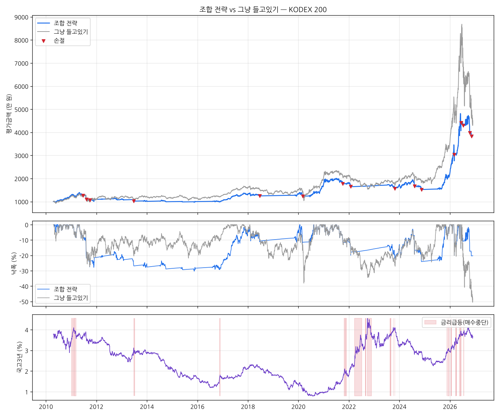

# 조합 전략 백테스트 (과거 데이터 시험)

**금리필터 + 듀얼모멘텀 + 분할매수 + 손절** 4가지 규칙을 섞은 전략을
KODEX 200(코스피200 ETF) 과거 주가로 시험해 보는 프로그램이야.

> ⚠️ **계산만 하는 프로그램이야.** 실제 주문, 증권사 연결 기능은 전혀 없어.

---

## 1. 전략 규칙 (쉬운 말로)

| 규칙 | 내용 | 기본값 |
|---|---|---|
| ① 금리 필터 | 국고3년 금리가 최근 60거래일(약 3개월) 동안 **0.5%p 이상 오르면** 새로 사지 않음 (가진 건 유지) | 60일 / 0.5%p |
| ② 듀얼모멘텀 | **매달 마지막 거래일**에 점검. 최근 12개월 주가 수익률이 같은 기간 현금(국고1년 금리) 수익보다 높으면 주식, 아니면 전부 팔고 현금. (`"모멘텀_사용": False`면 이 판단 없이 늘 주식) | 12개월 |
| ③ 분할매수 | 주식으로 들어갈 땐 한 번에 안 사고 **4번에 나눠 같은 금액씩**, 5거래일(약 1주)마다 | 4회 / 5일 |
| ④ 손절 | **산 뒤 가장 높았던 가격(고점)보다 -10%** 떨어지면 전량 매도 (추적 손절). 다음 달 말 점검 때 다시 삼. (`"손절_기준": "매수가"`로 바꾸면 평균 매수가 대비 -10%) | 고점 -10% |

> 💡 **고점 기준 손절이 뭐야?** 1만 원에 사서 1만5천 원까지 올랐다면, 1만5천 원의 -10%인 1만3,500원 밑으로 내려가면 판다는 뜻이야. 평균 매수가 기준(1만 원의 -10% = 9,000원)이면 1만5천 원에서 40% 가까이 빠져야 팔게 돼. 그래서 이번에 고점 기준을 기본으로 바꿨어.

- 현금으로 있을 땐 국고1년 금리만큼 이자가 붙는다고 가정해.
- 신호는 그날 **종가**로 판단하고, 실제 매매는 **다음 거래일 종가**로 처리해 (미래 정보를 미리 보는 반칙 방지).
  그래서 손절이 정확히 -10%가 아니라 -10.5%처럼 조금 더 깊게 찍힐 수 있어. 현실도 그래.
- 사고팔 때마다 비용 0.10% (수수료+체결 미끄러짐)를 뺐어.

## 2. 설정 바꾸는 법

`backtest.py` 파일 맨 위 **`SETTINGS`** 부분만 고치면 돼. 예를 들어 손절을 -7%로 바꾸려면:

```
"손절_퍼센트": 7.0,
```

종목을 바꾸려면 `"종목코드"`를 다른 ETF 코드로 바꾸면 돼 (예: TIGER 200 = `102110`).
데이터 파일(`data/prices_코드.csv`)은 코드별로 따로 저장돼.

### 들어있는 데이터 (바로 실행 가능)
| 파일 | 내용 | 기간 |
|---|---|---|
| `data/prices_069500.csv` | KODEX 200 종가 + 배당 반영 수정주가(AdjClose) | 2009-04 ~ 2026-11 |
| `data/prices_KOSPI.csv` | 코스피 지수 (배당 미반영) — 2008년 금융위기까지 보고 싶을 때 | 2000-01 ~ 2026-11 |

둘 다 야후 파이낸스에서 받은 값이야. 코스피 지수로 시험하려면 실행할 때 뒤에 `KOSPI`를 붙여:
```
python backtest.py KOSPI
```

### 데이터 직접 넣기
`data` 폴더에 `prices_코드.csv` 파일을 아래 모양으로 넣으면 그걸 써 (`AdjClose` 칸은 없어도 됨):
```
Date,Close,AdjClose
2024-01-02,35000,34500
```

---

## 3. 실행 방법 (윈도우 기준, 처음 한 번만 준비)

### ① 파이썬 설치 (이미 있으면 건너뛰기)
1. 웹브라우저에서 아래 주소로 가서 **Download Python** 노란 버튼 클릭
```
https://www.python.org/downloads/
```
2. 받은 설치 파일 실행 → 첫 화면 아래쪽 **"Add python.exe to PATH"** 체크 ✅ → **Install Now**

### ② 프로그램 받기
1. 웹브라우저에서 아래 주소로 이동
```
https://github.com/ndh4123/macro-rates
```
2. 초록색 **`<> Code`** 버튼 → **Download ZIP** 클릭
3. 받은 ZIP 파일을 오른쪽 클릭 → **압축 풀기** (또는 "모두 압축 풀기")

### ③ 명령창 열기
1. 압축 푼 폴더 안의 **`backtest`** 폴더로 들어가
2. 탐색기 위쪽 주소창(폴더 경로가 보이는 칸)을 클릭하고 `cmd` 입력 후 엔터
   → 검은 창(명령 프롬프트)이 그 폴더에서 열려

### ④ 필요한 부품 설치 (처음 한 번만)
검은 창에 아래 한 줄 붙여넣고 엔터:
```
pip install -r requirements.txt
```

### ⑤ 실행
```
python backtest.py
```

`data` 폴더에 들어있는 주가(2026-11-27까지)로 바로 결과가 나와.
**최신 주가로 다시 받고 싶으면** `data` 폴더 안의 `prices_069500.csv`를 지우고 다시 실행하면 인터넷에서 새로 받아 (1~2분).

### 조합 여러 개 한 번에 비교 (과최적화 점검 포함)
```
python compare.py
```
표 3개가 나와: ① 규칙 조합별 비교 ② 손절 %만 바꿔보기 ③ 기간을 앞/뒤로 나눠보기.
코스피 지수로 비교하려면:
```
python compare.py KOSPI
```

### 규칙이 제대로 움직이는지 확인 (선택)
```
python test_backtest.py
```
"모든 시험 통과"가 나오면 정상이야.

---

## 4. 결과 읽는 법

화면에 이런 표가 나와:

| 항목 | 뜻 |
|---|---|
| 총수익률 | 처음 돈 대비 몇 % 불었나 |
| 연평균수익률 | 매년 평균 몇 %씩 불었나 (복리) |
| 최대낙폭(MDD) | 가장 높았던 때에서 가장 많이 떨어졌을 때 몇 %였나. **버틸 수 있는 손실인지** 보는 숫자 |
| 그냥 들고있기 | 첫날 다 사서 아무것도 안 하고 끝까지 들고 있었을 때 (비교 기준) |

`results` 폴더에 저장되는 파일:
- `결과차트.png` — 위: 돈이 불어난 모습 / 가운데: 고점 대비 낙폭 / 아래: 국고3년 금리 (빨간 구간 = 금리급등으로 매수 중단)
- `거래기록.csv` — 언제 왜 사고팔았는지 (엑셀로 열림)
- `일별평가금액.csv` — 날짜별 평가금액

---

## 5. 실제로 돌려본 결과 (2026-11-28 실행)

> 아래 숫자는 `python compare.py`, `python compare.py KOSPI` 출력 그대로야.
> "고점손절" = 산 뒤 최고가 대비 -10% 손절. 조합에 안 적힌 규칙은 끈 상태 (분할매수도 끔).

### ① 조합 비교

**KODEX 200 (배당 포함, 2010-04 ~ 2026-11)**

| 조합 | 총수익률 | 연평균 | MDD | 손절 횟수 |
|---|---|---|---|---|
| 고점손절만 | **464.7%** | **11.0%** | -34.8% | 24 |
| 모멘텀 + 고점손절 | 223.5% | 7.3% | -38.1% | 16 |
| 금리필터 + 고점손절 | 408.3% | 10.3% | -34.8% | 24 |
| 모멘텀 + 금리필터 + 고점손절 | 223.9% | 7.3% | -38.1% | 16 |
| 4가지 다 (새 기본) | 284.2% | 8.4% | **-30.3%** | 16 |
| 4가지 다, 매수가손절 (예전 기본) | 210.7% | 7.1% | -50.5% | 0 |
| **그냥 들고있기** | 350.9% | 9.5% | -50.5% | - |

**코스피 지수 (배당 미반영, 2003-01 ~ 2026-11, 2008년 위기 포함)**

| 조합 | 총수익률 | 연평균 | MDD | 손절 횟수 |
|---|---|---|---|---|
| 고점손절만 | **953.8%** | **10.4%** | -49.4% | 41 |
| 모멘텀 + 고점손절 | 226.0% | 5.1% | -38.9% | 22 |
| 금리필터 + 고점손절 | 831.4% | 9.8% | -50.2% | 41 |
| 모멘텀 + 금리필터 + 고점손절 | 228.2% | 5.1% | -38.5% | 22 |
| 4가지 다 (새 기본) | 287.5% | 5.8% | **-33.8%** | 22 |
| 4가지 다, 매수가손절 (예전 기본) | 200.4% | 4.7% | -48.4% | 1 |
| **그냥 들고있기** | 673.9% | 8.9% | -54.5% | - |

**쉽게 말하면**
- **고점손절만** 쓴 게 두 시험 모두 수익 1등이었어. 대부분(약 92%) 주식에 있으면서 큰 하락 때만 빠져나왔기 때문이야.
- **모멘텀을 넣으면 수익이 확 줄어.** 현금으로 있는 기간이 절반 가까이 되면서 상승장을 많이 놓쳤어. 대신 MDD는 가장 작아 (-30%대).
- **금리필터는 수익을 조금 깎기만 했어** (KODEX 464.7% → 408.3%). 이 기간엔 도움이 안 됐어.
- 즉, **"덜 잃기"를 원하면 4가지 다, "더 벌기"를 원하면 고점손절만** 쪽이야. 둘 다 동시에 최고인 조합은 없었어.

### ② 숫자 흔들기 — 손절 %만 바꿔보기 (새 기본 기준)

| 손절 | KODEX 총수익률 / MDD | 코스피 총수익률 / MDD |
|---|---|---|
| -5% | 125.4% / -23.7% | 127.3% / -36.6% |
| -7% | 93.9% / -33.7% | 65.7% / -39.8% |
| -10% | 284.2% / -30.3% | 287.5% / -33.8% |
| -12% | 324.1% / -26.0% | 267.4% / -33.7% |
| -15% | 308.4% / -28.8% | 240.6% / -32.2% |
| -20% | 274.7% / -37.3% | 234.9% / -36.4% |

⚠️ **-7%와 -10%의 결과가 3~4배나 차이 나.** 숫자 하나 바꿨다고 이렇게 크게 흔들리면, 그 숫자가 "좋은 숫자"가 아니라 "과거에 운 좋게 맞은 숫자"일 수 있다는 신호야. -10%~-15% 구간은 비교적 비슷해서 그나마 덜 위험해 보여.

### ③ 기간 나누기 — 새 기본 vs 그냥 들고있기

| 기간 | 새 기본 총수익률 / MDD | 그냥 들고있기 총수익률 / MDD |
|---|---|---|
| KODEX 앞 절반 (2010-04 ~ 2014-12) | -0.2% / -28.8% | 15.4% / -27.4% |
| KODEX 뒤 절반 (2015-01 ~ 2026-11) | 285.0% / -24.1% | 290.0% / -50.5% |
| 코스피 앞 절반 (2003-01 ~ 2014-12) | 76.2% / -32.3% | 201.6% / -54.5% |
| 코스피 뒤 절반 (2015-01 ~ 2026-11) | 119.9% / -33.7% | 155.2% / -48.5% |

- 네 구간 모두 **수익은 그냥 들고있기가 이겼고, MDD는 전략이 더 작거나 비슷**했어. 결과 방향이 기간마다 일관된 건 좋은 신호야.

### ④ 끝나는 날짜에 따라 달라지는 것 (중요)

KODEX 200은 2026년 6월 고점 뒤 약 50% 빠진 상태로 시험이 끝나. 그래서 **하락 직전(2026-05-29)에 끝냈을 때**도 따로 봤어:

| 끝나는 날 | 고점손절만 | 그냥 들고있기 |
|---|---|---|
| KODEX 2026-05-29 | 722.7% / MDD -30.5% | 689.8% / MDD -38.1% |
| KODEX 2026-11-27 | 464.7% / MDD -34.8% | 350.9% / MDD -50.5% |
| 코스피 2026-05-29 | 1425.4% / MDD -49.4% | 1234.4% / MDD -54.5% |
| 코스피 2026-11-27 | 953.8% / MDD -49.4% | 673.9% / MDD -54.5% |

- 하락 전에 끝내도 고점손절만이 조금 앞섰지만, **차이는 훨씬 작아져** (KODEX 114%p → 33%p). 최근 급락 하나가 결과를 크게 부풀리고 있다는 뜻이야.


(차트는 새 기본 = 4가지 다 + 고점손절, KODEX 200)

## 6. ⚠️ 과최적화(오버피팅) 주의 — 꼭 읽기

**과최적화** = 과거 시험지 답을 외운 것처럼, 과거 데이터에만 딱 맞게 숫자를 조정하는 것.
예를 들어 손절을 -10%, -9%, -8%... 바꿔가며 제일 결과 좋은 숫자를 고르면,
그건 "앞으로도 잘 되는 숫자"가 아니라 "**과거에 우연히 잘 맞았던 숫자**"일 가능성이 커.

이렇게 확인해 봐:
1. **기간을 나눠 시험** — `시작일`/`종료일`을 바꿔 2003~2014년으로 숫자를 정하고, 2015년~ 기간에도 비슷하게 나오는지 본다.
2. **숫자를 조금씩 흔들어 본다** — 손절 -8%, -10%, -12%에서 결과가 비슷해야 튼튼한 규칙이야. 한 숫자에서만 좋으면 의심.
3. **거래 횟수가 적으면 운일 수 있다** — 손절이 몇 번 안 일어났다면 통계적으로 의미가 약해.
4. **과거 수익 ≠ 미래 수익.** 실제 돈을 넣기 전엔 소액이나 모의투자로 몇 달 지켜보기.
5. **"고점손절을 기본으로 바꾼 것" 자체도 같은 과거 데이터를 보고 고른 거야.** 그래서 이 선택도 과최적화일 수 있어. 진짜 검증은 앞으로의(아직 안 본) 데이터로만 할 수 있어.

## 7. 이 시험의 한계 (알고 쓰기)

- KODEX 200 데이터는 배당 반영 가격이지만 **2009년 4월부터만** 있어 (야후 자료에 2007~2009 구간이 비어 있음). 그래서 2008년 금융위기는 코스피 지수로 따로 봐야 해.
- 코스피 지수는 **배당 미반영**이야. 전략 쪽은 현금 이자를 받는데 들고있기 쪽은 배당을 못 받아서, 코스피 시험은 전략에 살짝 유리하게 나와 있어.
- 고점손절은 자주 사고팔아 (16~41번). 비용 0.10%는 넣었지만, 실제로는 호가 차이·심리적 부담(팔고 나서 바로 오르는 경우)이 더 있을 수 있어.
- 손절 뒤 다시 사는 시점을 "다음 달 말"로 정해뒀어. 이 규칙을 바꾸면 결과도 달라져.
- 현금 이자는 국고1년 금리로 단순 계산했어 (실제 예금·CMA 금리와 다를 수 있음).
- 하루에 종가 한 번만 보기 때문에, 장중에 -10%를 찍고 회복한 날은 손절로 안 잡혀.
- 세금(ETF 매매차익은 국내주식형이라 비과세, 분배금은 15.4%)은 반영 안 했어.
- 금리 데이터: 같은 저장소의 `rates_history.json`(1998~2026.7) + `rates.json`(최근 1년) — 한국은행 ECOS 자료.

---

## 8. 매일 모의투자 기록 (고점손절만, 가짜 돈)

백테스트에서 제일 좋았던 **'고점손절만'** 이 앞으로도 통하는지, **2026-11-30부터 매일** 가짜 돈으로 기록해.
계좌는 2개를 따로 굴려 (각각 1,000만 원):

| 계좌 | 사는 방법 | 파는 방법 |
|---|---|---|
| 한번에 사기 | 월말 신호 다음 거래일에 전부 | 산 뒤 최고 종가 -10% 아래로 마감하면 다음 거래일에 전부 |
| 4번 나눠 사기 | 월말 신호 뒤 1/4씩, 5거래일 간격으로 4번 | 같음 (다 사기 전에 걸리면 산 것만 팔고 다음 월말까지 대기) |

실제 주문·증권사 연결은 없어.

- **자동 실행**: GitHub Actions가 평일 **한국시간 17:30**쯤 알아서 돌려 (`.github/workflows/paper-trade.yml`).
  야후에서 KODEX 200 종가를 받고 (막히면 네이버), `paper_trade.py`로 계산해.
- **결과 보는 곳**: 저장소의 **`paper-log` 브랜치** (금리 장부가 올라가는 main과 섞이지 않게 따로 둠)
  - `README.md`(=`요약.md`): 두 계좌 vs 그냥 들고있기 성적표, 계좌별 상태, 손절선, 다음 할 일, 매매 내역, 최근 10일
  - `일지_한번에사기.csv`, `일지_4번나눠사기.csv`: 계좌별로 하루 한 줄 (한 번 적은 줄은 안 바꿈)
  - `가격기록.csv`: 그날 받은 종가 (한 번 적은 값은 안 바꿈)
- **바로 한 번 돌리기**: 저장소 **Actions** 탭 → 왼쪽 **모의투자 매일 기록** → **Run workflow** 버튼
- **내 컴퓨터에서 돌리기**: `backtest` 폴더에서 `python paper_trade.py` → `backtest/paper_log/` 폴더에 같은 파일이 생겨
- **규칙 점검**: `python test_paper_trade.py` (과거 1년치를 하루씩 넣어 보며 기록이 앞뒤 맞는지 확인)

규칙: 월말 종가 보고 다음 거래일에 전부 삼 → 산 뒤 최고 종가 대비 -10% 아래로 마감하면 다음 거래일에 전부 팜 → 다음 월말까지 현금(국고1년 이자) → 다시 삼.
비교 기준 '그냥 들고있기'는 시작일 종가에 전부 산 것. 둘 다 배당은 빼고 실제 종가로 계산해.
